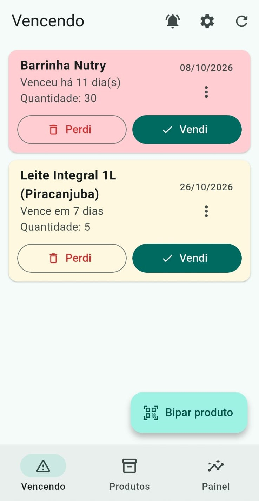
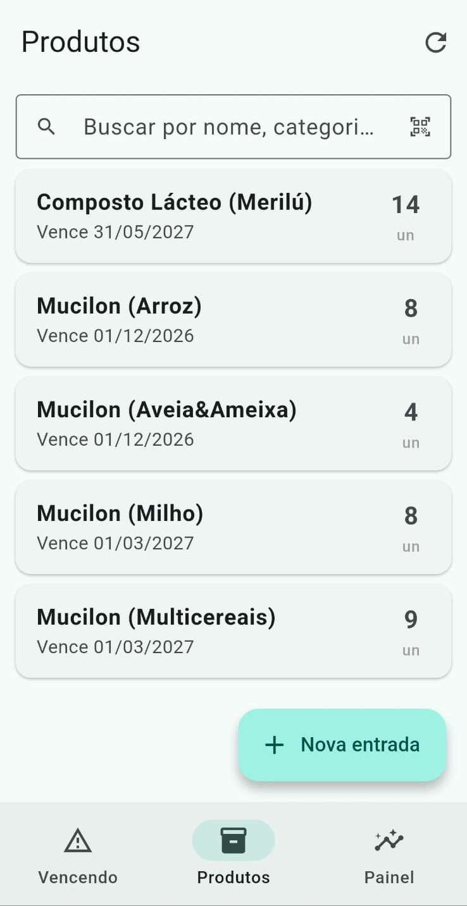
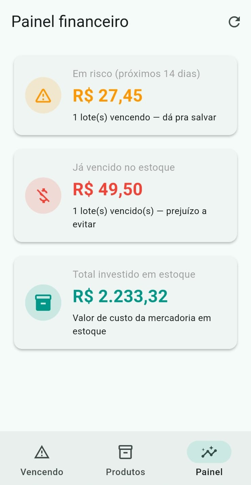

# Vality — controle de estoque com alerta de validade

Sistema que avisa quando produtos estão perto de vencer, construído para um
mercado de bairro e **em uso diário por duas funcionárias** desde outubro de 2026.

<p align="center">
  
  
  
</p>

---

## O problema

O Mercado Nordeste perdia mercadoria todo mês por produto vencido descoberto
tarde demais. A conferência era manual: alguém ia até a prateleira, olhava data
por data, e inevitavelmente passava algo.

O sistema de PDV da loja (DataPro) controla venda e emissão fiscal, mas não
acompanha validade por lote. Trocar o PDV inteiro por causa disso não fazia
sentido — o que faltava era uma camada em cima, não um substituto.

## A solução

Um backend local e um app Android. Quando chega mercadoria, a pessoa bipa o
código de barras, informa quantidade e validade. Todo dia às 13h o app avisa
o que está perto de vencer, com nome e quantidade de cada item.

| Chegada | Alerta | Baixa |
|---|---|---|
| Bipa o código, informa validade e custo | Notificação às 13h com a lista | Marca "Perdi" ou "Vendi" |

---

## Decisões de arquitetura

### 1. Adapter para a origem das saídas

O objetivo de longo prazo era dar baixa automática a cada venda do PDV. Duas
barreiras: o DataPro não expõe API pública, e a integração com a Stone exige
cadastro formal como parceiro.

Em vez de travar o projeto esperando isso, defini uma interface:

```python
class FonteDeSaida(ABC):
    @abstractmethod
    def registrar_saida(self, db, lote_id, quantidade, tipo): ...
```

Hoje existem `SaidaManual` e `SaidaScanner`. No dia em que a integração for
possível, `SaidaStoneAPI` entra como mais uma implementação — nenhum endpoint
muda. O custo de tomar essa decisão cedo foi quase zero; o custo de não tomar
seria reescrever a camada de movimentação inteira.

### 2. Produto e lote são entidades separadas

O código de barras identifica o **produto**, que é cadastrado uma vez. Cada
chegada vira um **lote**, com sua própria validade, custo e fornecedor. Um
mesmo produto pode ter três lotes com três datas diferentes na prateleira.

Toda saída também gera um registro em `MovimentacaoEstoque`, que é imutável.
Isso significa que apagar estoque nunca apaga histórico — o painel financeiro
consegue dizer quanto foi perdido por vencimento ao longo do tempo.

### 3. Notificação por agendamento, não por execução em background

A primeira versão usava `workmanager`: o app acordava todo dia, consultava o
servidor e montava o aviso. Funcionava, mas dependia do Android resolver
executar o processo — e, em celulares Samsung com otimização de bateria
agressiva, isso é incerto.

A observação que mudou o desenho: **validade é dado determinístico.** Se um
lote vence dia 30, já se sabe hoje que no dia 23 ele estará a 7 dias de vencer.
Não há nada a descobrir em tempo de execução.

Então o app passou a calcular todas as datas de uma vez e deixar as
notificações agendadas no próprio sistema operacional, com o texto já pronto:

```dart
// o aviso é escrito na perspectiva da data em que vai tocar,
// não da data em que foi agendado
final d = _soData(lote.dataValidade).difference(dia).inDays;
```

Resultado: uma dependência a menos, nenhuma execução em background, e o alerta
funciona mesmo com o app fechado há dias. O trade-off aceito é que um produto
vendido depois do agendamento ainda gera aviso — corrigido naturalmente porque
o reagendamento roda sempre que a lista é carregada.

### 4. Backend local, não em nuvem

Custo zero de hospedagem, funciona sem internet e o dado de estoque não sai
da loja. O celular conecta pelo Wi-Fi interno. O endereço do servidor é
configurável dentro do app, então mudança de IP não exige gerar APK novo.

---

## Stack

**Backend:** Python, FastAPI, SQLAlchemy, SQLite, APScheduler
**App:** Flutter, `mobile_scanner`, `flutter_local_notifications`
**Integração:** HTTP REST na rede local

## Estrutura

```
vality_system/
├── back_end/
│   ├── main.py              # endpoints
│   ├── models.py            # Produto, Lote, MovimentacaoEstoque
│   ├── schemas.py           # validação Pydantic
│   └── services/
│       ├── fonte_venda.py   # o adapter
│       ├── alertas.py       # regra de "o que está vencendo"
│       ├── notificacao.py   # e-mail
│       └── agendador.py     # job diário
└── vality_app/
    └── lib/
        ├── models/          # espelham o backend
        ├── services/        # ApiService e NotificacaoService
        └── screens/         # 8 telas
```

## API

| Método | Rota | O que faz |
|---|---|---|
| `POST` | `/produtos` | Cadastra produto (nome + código de barras) |
| `GET` | `/produtos` | Lista o catálogo |
| `GET` | `/produtos/{id}/lotes` | Lotes de um produto, inclusive zerados |
| `DELETE` | `/produtos/{id}?forcar=` | Exclui; recusa com 409 se houver estoque |
| `POST` | `/produtos/{id}/lotes` | Registra entrada de mercadoria |
| `POST` | `/lotes/{id}/saida` | Dá baixa (perda ou venda) |
| `DELETE` | `/lotes/{id}` | Exclui lote (correção de cadastro) |
| `GET` | `/alertas/vencendo?dias=14` | O que está perto de vencer |

---

## Rodando localmente

```bash
cd back_end
pip install -r requirements.txt
uvicorn main:app --host 0.0.0.0 --port 8000
```

Documentação interativa em `http://localhost:8000/docs`.

```bash
cd vality_app
flutter pub get
flutter run
```

No app, em Configurações, aponte para `http://SEU_IP:8000`.

---

## Próximos passos

- Autenticação por token — hoje a API é aberta na rede local
- Contagem de inventário e alerta de ruptura (o campo `estoque_minimo` já existe)
- FEFO automático: dar baixa primeiro no lote que vence antes
- Relatório de giro por produto

---

Feito por [Kauã Ribeiro Mota](https://github.com/KauaMotaa) —
estudante de Engenharia de Software na UniCatólica (Palmas, TO).
